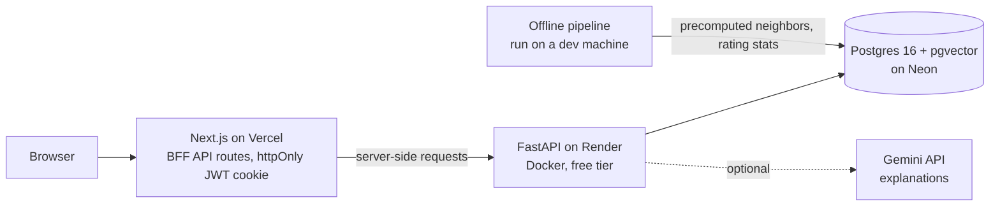

# Plotline

**Live demo: [plotline-nine.vercel.app](https://plotline-nine.vercel.app)**

Plotline is a full-stack movie recommendation app. It combines **collaborative filtering** (what people with similar taste rated highly) with **content-based filtering** (genres, director, cast, plot), explains each pick in plain English, and shows where to stream it.

> **Heads-up on the demo:** everything runs on free tiers ($0/month). The backend sleeps after 15 minutes without traffic, so the **first request after a quiet period can take about a minute** while it wakes up. After that, it's fast.

## Features

- **Accounts:** email/password sign-up and login with JWT sessions in an httpOnly cookie; 7-day sessions that redirect to the login page with a clear message when they expire
- **Onboarding:** a cold-start quiz (favorite genres + favorite movies) so new users get recommendations before rating anything
- **Home:** "Recommended for You", "Because you like …" genre rows and trending movies, in carousels with arrow navigation
- **Movie pages:** poster, year, original language, director, cast, TMDb and Plotline ratings, US streaming/rent/buy providers, star rating, watchlist button, and **"Why this was recommended"**
- **Search:** by title (punctuation-insensitive, e.g. "spiderman" finds "Spider-Man") and genre, sorted by popularity
- **Watchlist and profile:** ratings history, editable taste profile, password change
- **Light / Dark / System theme** that follows the device setting, with no flash of the wrong theme
- **AI explanations** from Google Gemini, with an automatic templated fallback when the free quota runs out

## Architecture



- **Backend-for-frontend:** the browser only talks to Next.js. Next.js API routes call FastAPI server-side and keep the JWT in an httpOnly cookie, so it's never readable by page JavaScript.
- **Offline / online split:** anything that needs the full 6.45M-rating dataset runs offline. Production only stores and serves the precomputed results (see below).

## How recommendations work

**Data:** the MovieLens `ml-latest` dataset (6.45M ratings), enriched with TMDb metadata (cast, crew, posters, watch providers, original language): 10,423 movies, including ~500 recent releases from TMDb.

**Offline** (`app/scripts/build_offline_artifacts.py`, ~50 s):
1. **Collaborative filtering:** builds a sparse user × movie rating matrix and computes cosine similarity between movies in 1,000-movie chunks (float32), keeping each movie's **top 50 neighbors**. It never materializes a dense movie × movie matrix.
2. **Content-based:** TF-IDF over genres, director, top cast and description; top 50 neighbors per movie.
3. **Plotline rating:** average and count per movie.

Results go into a `movie_neighbors` table (~1M rows) and columns on `movies`.

**Online** (on onboarding save or rating):
- Each method is **a single SQL query** over the user's own ratings and their movies' precomputed neighbors, combined by a hybrid scorer with popularity/recency and watchlist signals.
- Recommendations are **saved before the response returns** (with instant templated explanations), so the home page has them immediately. Gemini then rewrites the explanations **in a background task**, one row at a time.
- A **circuit breaker** stops calling Gemini for the retry period the API reports after a quota error, instead of retrying every movie.

**Why this design:** the first version recomputed similarity from all 6.45M ratings and held two dense ~10k × 10k matrices (~1.7 GB) in memory. Moving that work offline and serving from SQL:

| | Before | After |
|---|---|---|
| Recommendation generation | ~27 s | near-instant (one SQL query per method) |
| In-memory similarity matrices | ~1.7 GB | none |
| Database size | 2.45 GB | 291 MB in production |
| Production image / memory | — | 884 MB image, ~170 MB RAM serving |

## Tech stack

- **Frontend:** Next.js 16 (App Router, TypeScript), Tailwind CSS v4, next-themes
- **Backend:** Python 3.12, FastAPI, SQLAlchemy, Alembic, Pydantic
- **Database:** PostgreSQL 16 with pgvector
- **Recommendations:** SciPy sparse matrices, scikit-learn (cosine similarity, TF-IDF), precomputed neighbor tables
- **AI:** Google Gemini (`google-genai`) for explanations
- **Data:** MovieLens `ml-latest` + TMDb API
- **Testing:** Pytest (54 backend tests), Jest + React Testing Library (45 frontend tests)
- **CI:** GitHub Actions: ruff + Pytest against a Postgres/pgvector service container + Docker build; ESLint + Jest + Next.js build
- **Hosting:** Vercel (frontend), Render (backend, Docker), Neon (Postgres), all on free tiers; merges to `main` auto-deploy

## Testing

```bash
# Backend (needs the local Postgres container running)
cd backend && source venv/bin/activate && python -m pytest

# Frontend
cd web && npm test
```

Frontend tests mock `fetch` and `next/navigation`, so they run without a backend. They cover the login page (success, wrong password, 422 validation errors, network failure, session-expired banner), onboarding (genre loading, debounced search, save payload, loading overlay, error paths), `MovieCard`, `FormField`, and error parsing.

## Running locally

**Prerequisites:** Git, Python 3.12, Node 22, Docker.

**1. Database** (Postgres 16 + pgvector in Docker):

    docker compose -f infra/docker-compose.yml up -d db

**2. Backend:**

    cd backend
    python3 -m venv venv
    source venv/bin/activate
    pip install -r requirements-dev.txt   # requirements.txt is production-only
    cp .env.example .env                  # then fill in values
    python -m alembic upgrade head
    python -m uvicorn app.main:app --reload

**3. Frontend:**

    cd web
    npm install
    cp .env.example .env.local            # BACKEND_API_URL=http://localhost:8000
    npm run dev

### Environment variables

| Variable | Where | Required | Purpose |
|---|---|---|---|
| `DATABASE_URL` | backend | yes | Postgres connection string |
| `JWT_SECRET_KEY` | backend | yes | signs session tokens; use a unique random value per environment |
| `GEMINI_API_KEY` | backend | no | AI explanations; without it, templated explanations are used |
| `TMDB_API_KEY` | backend | no | only for the data-ingestion scripts |
| `ACCESS_TOKEN_EXPIRE_MINUTES` | backend | no | defaults to 7 days |
| `BACKEND_API_URL` | web | yes | where Next.js reaches FastAPI |

### Building the dataset

The raw data isn't committed. The pipeline scripts live in `backend/app/scripts/`:

1. `load_movielens.py`: load the MovieLens CSVs, keep the 10,000 most-rated movies and the most active users, and filter ratings down to them
2. `fetch_tmdb.py`: fetch TMDb details, credits and watch providers for each movie in one call, cached to disk (safe to re-run); `fetch_recent_movies.py`: fetch ~500 popular releases from the last ~3 years via TMDb's discover endpoint
3. `ingest_to_db.py` / `ingest_recent_movies.py`: upsert movies, cast/crew and providers into Postgres and bulk-insert the ratings; MovieLens users become placeholder accounts (no usable password) so ratings reference real `users` rows
4. `generate_embeddings.py`: local sentence-transformers embeddings of each movie's genres, description, cast and director for semantic search (no API calls)
5. `build_offline_artifacts.py`: precompute neighbors and Plotline ratings
6. `backfill_original_language.py`: fill in original languages from the TMDb cache

### Deploying

Production was built by migrating a fresh Neon database (`alembic upgrade head`) and running `export_to_production.py`, which copies only what the live app needs (movies, cast/crew, US watch providers, precomputed neighbors) in one transaction with row-count checks, then rebuilds the vector index. User accounts and the raw MovieLens ratings are not copied.

## Current limitations

- **Cold starts** of about a minute on the free backend tier
- **Watch providers are US-only** in the live demo, to keep the database within the free tier
- **Semantic ("search by plot") search** is built (pgvector + sentence-transformers) but hidden; the production image ships without PyTorch to fit in 512 MB of RAM
- **Password reset** works in development mode only (the reset token is shown on screen; no email is sent)
- **Gemini's free tier** allows only a small number of requests per day, after which explanations use the templated fallback

## Roadmap

- Language filter on search
- End-to-end tests for server-rendered pages (e.g. Playwright)
- TV shows, with content-based recommendations as a cold-start fallback until enough ratings exist
